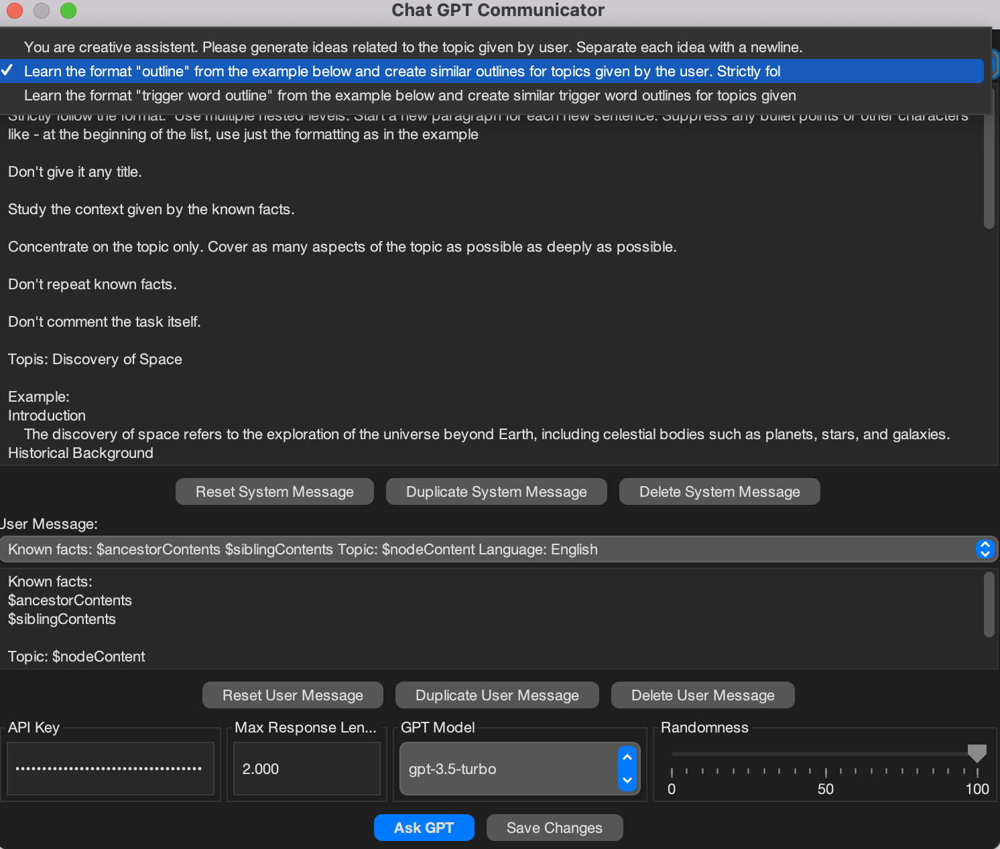
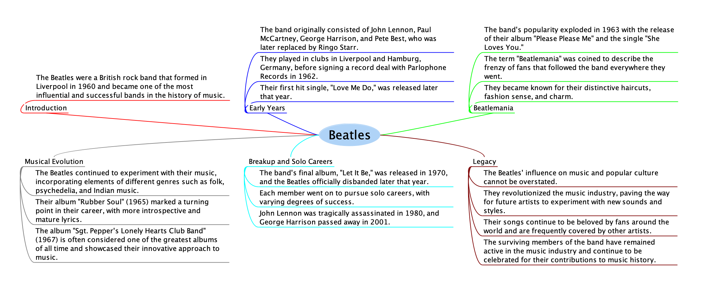

# An add-on for freeplane that uses LLM APIs to brainstorm ideas from any selected node

> **Demos, screencasts and project updates:** https://onticfabric.com/

## Features
- **Quick Prompt (Ctrl+Alt+G):** Generate ideas or expand nodes using a pre-configured prompt with a single shortcut.
- **Compare Connected Nodes (v0.4.0):** Analyze linked nodes using custom comparison types (e.g., Pros/Cons, Strengths/Weaknesses) and add structured results as child nodes.
- **Customizable Prompts:** Configure system and user message templates to tailor LLM interactions.
- **Multiple LLM Providers:** Supports OpenRouter API for multi-model support and OpenAI.
- **Branch Generation:** Automatically appends LLM responses as mind map branches.
- **Automatic Tagging:** Generated branches are automatically tagged with the model name used (e.g. `LLM:gpt-4`) for easy tracking of AI-generated content
- **Model Identification:** Tags appear in node notes showing which LLM model generated each branch
- **Recursive Tagging:** Tags are applied to all child nodes in generated branches for complete provenance

Communicator window


-----------

Prompt sent


-----------
Response returned


## Compare Connected Nodes (v0.4.0+)
Analyze relationships between two connected nodes using structured comparisons:

1. **Create Connection** - Add a connector between two nodes
2. **Select Both Nodes** - Select the two connected nodes
3. **Invoke Comparison**:
   - Menu: `Tools > LLM AddOn > Compare Connected Nodes`
   - Shortcut: None (configurable via preferences)
4. **Choose Comparison Type**:
   - Select from common types (Pros/Cons, Strengths/Weaknesses etc.) from the dropdown.
   - Or enter a custom comparison type (e.g., "Cost vs Benefits") directly into the box.

The add-on can:
- Query the LLM to analyze both nodes based on your comparison type using a dedicated prompt.
- Add structured results as child nodes under each of the selected nodes.
- Save any newly entered custom comparison types for quick reuse in the dropdown next time.
- Potentially compare model outputs

### Setup
Install add-on using the LLM-AddOn-v0.9.19.addon.mm file. Other files are used for development only.

# Pre-requisites

Check-list before starting
- [ ] I have an **OpenRouter or Open AI account**
- [ ] **Freeplane app is installed** on my computer
- [ ] **LLM add-on is installed** in Freeplane.

# Step by step configuration of Freeplane Open AI add-on

## In your Open Router Account

1. **Go to** web page https://openrouter.ai/settings/keys
2. **Log in** using MetaMask or other method
3. **Add credit** to your account using crypto currency or other method
4. **Create Key** by clicking on "Create Key" button like shown bellow and finally **copy this newly generated key**.

## Alternatively, in your Open AI Account

1. **Go to** web page https://platform.openai.com/account/api-keys
2. **Log in** using your ChatGPT account
3. **Create a new Key** by clicking on "Create a new secret Key" button like shown bellow and finally **copy this newly generated key**.


## In Freeplane, first use

1. Click on the **LLM** top menu, click **Configure Prompts and Model**
2. Select your API provider
3. **Paste an API key** into the field "API key".
4. Click **Save Changes**

... you're done.

## Recent Features
### v0.9.19
- **Release-asset update channel**: update checks use `releases/latest/download/version.properties`, avoiding GitHub raw branch caching entirely. `version.properties` is attached to every release.

### v0.9.18
- **Canonical update channel**: update checks use GitHub's `refs/heads/main` raw URL, avoiding stale branch-name caching.

### v0.9.17
- **Public release hygiene**: internal local paths, LAN/test identifiers and generated neurOS card artifacts removed from tracked public content.
- **Demo hub**: https://onticfabric.com/ is linked in the README, help and add-on description.

### v0.9.16
- **Surface-node preview handling**: invoking Preview on a surface branch now says to expand it and select an entry, rather than attempting to read the directory as content.

### v0.9.15
- **Post-population collapse**: after the full catalog is built, All knowledge types and Supported content are explicitly collapsed as a final step.

### v0.9.14
- **Fold after child creation**: All knowledge types and Supported content are collapsed after their children are populated, so child creation cannot reset the default state.

### v0.9.13
- **Reliable default folding**: use Freeplane's explicit `setFolded(true)` API for All knowledge types and Supported content; older catalog branches retain their previous expanded state and should be recreated.

### v0.9.12
- **Correct source previews**: prefer the browsed listing file over canonical by-id links when it is readable, so task previews show actual Markdown content even when by-id is missing or belongs to another scope.
- Direct source reads no longer fall back to displaying the filename as if it were content.

### v0.9.11
- **Clearer catalog hierarchy**: curated surfaces are distinct from the full primitive vocabulary in All knowledge types. All knowledge types and Supported content are folded by default to reduce duplication and cognitive load.

### v0.9.10
- **Runtime Markdown fix**: package `markedj` and `jsoup` in the add-on lib so Markdown preview works in Freeplane, not only in tests.
- **Preview accelerator**: `Ctrl+Alt+P`, checked against default and user shortcut tables.

### v0.9.9
- **State-aware work surfaces**: state-machine metadata from the live cartridge filters stateful listings to actual state-tagged work items. Repository documents without `list`/`status`/`state` no longer masquerade as tasks; state is shown in result notes.
- No surface names, lane names or subtype filters are hardcoded.

### v0.9.8
- **Embedded PlantUML previews**: cached PNGs are also attached as Freeplane external objects at 50% zoom, so the preview is visible directly in the map as well as through rollover notes.

### v0.9.7
- **Live browse refresh**: invoking Browse on an already-expanded surface replaces only generated result/load-more children, so newly ingested entries appear without restarting Freeplane or losing user-created nodes.

### v0.9.6
- **Preview diagnostics**: log source type, render success, cache path, note priming and dialog display through Freeplane's standard `LogUtils` files.

### v0.9.5
- **Safe editing guardrail**: direct maps on knowledge surfaces are search/browse/preview only. Saving branches requires a local watched workspace with a `*_KNOWLEDGE` link, so the add-on does not encourage lock-sensitive `.mm` editing on network mounts.

### v0.9.4
- **Warm-up tolerant discovery**: `cartridge-contract` is accepted as an enablement marker alongside `README.cartridge`, and a 9P mount's `aname` supplies scope while `watcher-status` is unavailable.

### v0.9.3
- **On-demand content preview**: `LLM > Preview neurOS Content` or right-click → Preview neurOS Content.
- **Native Markdown rendering** through Freeplane's own Markdown plugin, with the source primed into the note for rollover rendering.
- **PlantUML preview** via the `plantuml` CLI, with bounded input/output, a timeout and cached PNGs. The preview note contains a Markdown image so later rollovers do not re-render the diagram.
- Process execution is enabled only for the two preview scripts; search, browse and save remain execution-disabled.

### v0.9.2
- **Intelligent Inquiry shortcut**: `Ctrl+Alt+I` (verified against default and user shortcut tables).
- **No recursive catalogs**: invoking Browse on a result opens its source material instead of nesting another catalog. Metadata entries show their descriptions instead of expanding.

### v0.9.1
- **Node context-menu browsing**: right-click any node and choose Browse neurOS Knowledge to expand it directly.
- **Keyboard accelerator**: `Ctrl+Alt+I` invokes Browse on the selected node.

### v0.9.0
- **Lazy Knowledge Catalog and Browse mode**: `LLM > Browse neurOS Knowledge` discovers the current cartridge's surface roots, primitive types, MIME routing and door capabilities from live metadata — never hardcoded types.
- **Bounded expansion**: selecting a surface or type loads one page of entries; Load more appends the next page. Truncation is reported honestly.
- **Network-safe listings**: no per-entry `stat` storm on dynamic mounts, and no semantic query during browsing.
- **Human-readable results**: identifiers are stripped from titles, with declared subtypes used as readable fallbacks.

### v0.8.3
- **Scoped writable network surfaces**: maps on writable 9P mounts now get a write destination even when they do not use the global `/scopes/<scope>` layout. Scoped FUSE knowledge surfaces remain search-only unless reached through a watched workspace.

### v0.8.2
- **Resilient dynamic queries**: query surfaces are opened directly and retried a small bounded number of times while the search index warms or the source is busy. Errors now explain the situation honestly instead of referring to removed settings.

### v0.8.1
- **Map-location discovery**: no neurOS location or scope configuration tool. A map inside a neurOS knowledge surface or watched workspace discovers its own context from `README.cartridge` and the workspace's `*_KNOWLEDGE` link.
- **Scope follows the open map**: ordinary Freeplane hyperlinks to maps in other knowledge scopes work naturally; searches in the newly opened map use that map's scope.
- **Clear enablement**: maps in plain directories simply hear that neurOS is not enabled; nothing asks for a mount path or guesses a default.

### v0.8.0
- **Map-scoped neurOS knowledge**: every map stores its own knowledge location, explicitly chosen scope and write destination. A new map starts unconnected, and operations never widen beyond the current scope without confirmation.
- **Context-rich search**: one semantic query combines the selected node with bounded ancestor, child and note context for substantially more precise recall — never one query per neighbour.
- **Human-first results**: search results show readable titles, types and an open-source link; identifiers and implementation paths stay behind the scenes.
- **Transport-neutral sources and destinations**: any filesystem path exposing the standard neurOS read surfaces works, including local daemon mounts and writable network filesystems. The interface talks about knowledge locations, never transports.
- **Safe resource defaults**: bounded results, context budgets and confirmation waits, with loud validation rather than silent fallbacks.

### v0.7.0
- **neurOS Bridge (opt-in)**: connect the add-on to a [neurOS](https://github.com/barrymac) knowledge mount — the filesystem surface of a personal knowledge substrate.
  - `LLM > Configure neurOS`: set the mount path, watched workspace path, result limit and card directory. Nothing is configured by default; features refuse loudly until configured.
  - `LLM > neurOS: Search Knowledge from Node`: semantic search of the mount's corpus using the selected node as the query; results are attached as a tagged branch with uuid notes.
  - `LLM > neurOS: Push Branch as Card`: push the selected branch into the mount's workspace as a work-graph card (`.card.md`), auto-ingested by the substrate, with the ingest uuid recorded back on the node.
- **Model catalogue refresh (Nov 2026)**: current OpenRouter and OpenAI models; add your own via the existing model list editor.
- **Modern OpenAI parameter compatibility**: newer OpenAI models (gpt-5+/gpt-6*/o-series) get `max_completion_tokens` and no `temperature`, so they work without API errors; classic models and OpenRouter keep the legacy parameters.
- **Toolchain refresh**: Gradle wrapper 8.14.3, Spock 2.5, JUnit BOM 5.14.4; test suite revived (74 green).
- Auto-update URL and OpenRouter attribution headers now point at this repository.

### v0.6.0
- **Image Generation**: Added a new feature to generate images based on node content using the Novita.ai API.
  - Accessed via `Tools > LLM AddOn > Generate Image`.
  - Uses selected node text as the base prompt.
  - Optionally enhances the prompt using configured LLM (OpenAI/OpenRouter) if no user template exists.
  - Prompts for Novita.ai API key if not configured.
  - Features an "Edit Image Generation Parameters" dialog:
    - Edit the prompt template (supports variables like `$nodeContent`, `$generatedPrompt`).
    - Adjust generation parameters (Steps, Width, Height, Image Count) using sliders.
    - Slider values are automatically saved on release as user defaults.
    - Save custom prompt templates and parameters.
    - Reset to default template and parameters.
  - Background image generation with a cancellable progress dialog.
  - Attaches the generated image (or user-selected image if multiple are generated) to the node.
  - See `docs/HELP.md` for detailed usage instructions.

### v0.4.1
- **Automatic LLM Tagging**: Added recursive model identification tags to all generated content
  - Visible `LLM:<model>` tags in node cores
  - Full model version in node notes
  - Tags propagate through all child nodes
- Improved error handling for API calls

### v0.4.0
- Added "Compare Connected Nodes" feature for analyzing node relationships using a dedicated prompt and custom comparison types.
### v0.3.6
- **Quick Prompt Shortcut**: Use `Ctrl+Alt+G` to instantly generate content using your saved settings
- **Direct API Access**: Choose between OpenRouter or OpenAI

To modify saved settings:
1. Go to **LLM > Configure Prompts & Model**
2. Adjust settings and click "Save Changes"

## Prompt template
The default prompt should be found in the add-on configuration.
It is a good starting point for brainstorming ideas. You can change it to suit your needs.

The following variables are replaced by the add-on:
- `$nodeContent` is replaced with the text of the selected node
- `$siblingContents` is replaced with the sibling branches of the selected node
- `$ancestorContents` is replaced with the child branches of the selected node

- `$rootText` can also be used to ground the model in the root context of the map

Using that default template LLM will be asked to generate ideas related to the selected node.

## Improvements
Prompt and feature suggestions are very welcome!

### Work in progress / future release
- [] Better prompt engineering for image generation 
- [] neurOS bridge: pull cards by label into a map (board → mind map direction)

For other feature ideas check the [project roadmap](docs/ROADMAP.md)

## neurOS knowledge (opt-in, per map)

The neurOS features discover their connection from the map itself. There is no
neurOS location or scope configuration tool.

A map is enabled when either:

- it lives inside a neurOS knowledge surface with `README.cartridge` or
  `cartridge-contract`, or
- it is in a watched workspace with a valid `*_KNOWLEDGE` link to one.

Otherwise, the search and save actions simply explain that neurOS is not
enabled for this map.

1. `LLM > Browse neurOS Knowledge` — create a lazy catalog from the live
   cartridge. Select a surface or type and invoke Browse again to expand one
   bounded page; use Load more for subsequent pages.
2. `LLM > Search neurOS Knowledge` — send one context-rich query to the current
   map's own scope. Results arrive as a readable branch; each result links to
   its source material without exposing identifiers.
3. `LLM > Preview neurOS Content` — render Markdown natively or PlantUML through
   the CLI on demand, with cached PNGs for later rollovers.
4. `LLM > Save Branch to neurOS` — save a selected branch to the workspace
   discovered from the map. Saving confirms the destination first and reports
   availability honestly.

Following an ordinary Freeplane hyperlink to a map in another knowledge scope
switches the effective scope when that map opens. No manual cross-scope setup
is required for map-to-map navigation.

The interface is transport-neutral and domain-agnostic: it never mentions the
filesystem technology behind a knowledge location and never hardcodes entity
types, relationship names or scopes.

## Building from source

```bash
./gradlew test          # JDK 17–23 (the freeplane toolchain predates JDK 24)
./gradlew packageAddon  # JDK 17 (Freeplane 1.12.x launcher uses the Security Manager)
```

`FREEPLANE_HOME` may point at your Freeplane installation; the default is
`~/bin/freeplane-<version>` per `build.gradle`.

## Tagging
All AI-generated branches are automatically tagged with:
- Model name in format `LLM:<model_name>` (e.g. `LLM:gpt-4` or `LLM:claude-2`)
- Full model identifier in node notes
- Tags applied recursively through all child nodes

Example tagged node:
```
[LLM:gpt-4]
<!-- Model: gpt-4-0613 -->
Generated content here...
```

This helps:
1. Track which model version generated content
2. Identify AI-generated nodes at a glance
3. Maintain transparency about content origins

