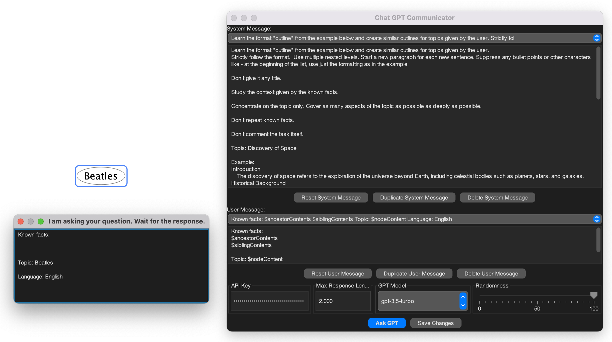
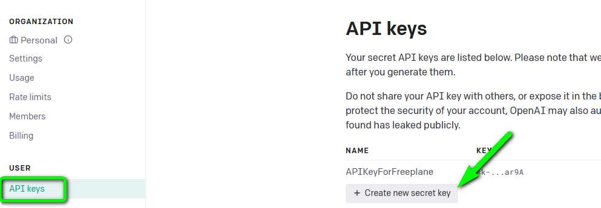

# LLM Add-on for Freeplane

Use LLM models to brainstorm, compare and expand mind-map branches — with an
optional neurOS knowledge integration for searching, browsing and previewing a
personal knowledge substrate from inside Freeplane.

**Demos, screencasts and project updates:** https://onticfabric.com/

**Latest release:** https://github.com/barrymac/freeplane_ml_addon/releases/latest

---

## What it does

### LLM features

- **Quick Prompt** (`Ctrl+Alt+G`) — expand the selected node with your saved prompt and model.
- **Compare Connected Nodes** — compare linked nodes using built-in or custom dimensions.
- **Generate Image** — create and attach images through Novita.ai, optionally enhancing the prompt with an LLM.
- **Prompt and model configuration** — choose OpenRouter or OpenAI, select a model and edit system/user prompts.
- **Branch generation with provenance** — generated branches are tagged with the model that produced them.

### Optional neurOS knowledge features

neurOS is a personal knowledge substrate exposed as a filesystem-like knowledge
surface. If neurOS is installed and the current map is in an enabled location,
the add-on can:

- **Search neurOS Knowledge** — one context-rich semantic query using the selected
  node plus bounded map context.
- **Browse neurOS Knowledge** (`Ctrl+Alt+I`) — a lazy catalog of curated surfaces,
  knowledge types, doors and supported content. Metadata sections are collapsed
  by default; listing pages are bounded and refreshed on demand.
- **Preview neurOS Content** (`Ctrl+Alt+P`) — native Markdown rendering and
  on-demand PlantUML previews. Rendered diagrams are cached, embedded in the map
  and made available to Freeplane rollovers.
- **Save Branch to neurOS** — save a branch as a work-graph card to the local
  watched workspace discovered from the map.

The neurOS integration is **additive and opt-in**. Without a neurOS installation,
the standard LLM features work unchanged and the knowledge actions simply explain
that neurOS is not enabled for the current map.

---

## Screenshots

### LLM workflow

**Communicator window**


**Prompt sent from a node**



**Generated response returned as a branch**


**API provider setup**



### neurOS knowledge exploration

NeurOS browse, preview and knowledge-graph screenshots will be added here.
Screen-capture demos are also published at https://onticfabric.com/.

## Prerequisites

- **Freeplane** 1.11.3 or newer. Tested with Freeplane 1.12.11.
- **Java** supported by your Freeplane installation (Java 17–23 for Freeplane 1.12.x).
- **An LLM provider account and API key**:
  - OpenRouter, or
  - OpenAI.
- **Novita.ai API key** — only needed for image generation.
- **Optional: neurOS**
  - A running neurOS substrate with a mounted knowledge surface, and/or
  - a watched workspace containing a `*_KNOWLEDGE` link to one.
  - The add-on discovers the knowledge location and scope from the current map.
    There is no mount-path or scope configuration screen.
  - Editable maps should live in a local watched workspace. Do not live-edit `.mm`
    files directly on network knowledge mounts unless that mount supports
    Freeplane's file-locking behavior.

---

## Installation

1. Download the latest `LLM-AddOn-*.addon.mm` from the
   [releases page](https://github.com/barrymac/freeplane_ml_addon/releases/latest).
2. Open the downloaded add-on in Freeplane and confirm installation.
3. Restart Freeplane.
4. Open **LLM → Configure Prompts and Model**, choose a provider and enter your API key.

For neurOS, also make sure the current map is inside an enabled knowledge
location or watched workspace. No manual neurOS configuration is required.

---

## Quick start

### Standard LLM workflow

1. Select a node.
2. Press `Ctrl+Alt+G` for Quick Prompt, or use the **LLM** menu for the other actions.
3. Configure the prompt, model and API provider from **LLM → Configure Prompts and Model**.

### neurOS workflow

1. Open a map stored in a neurOS-enabled local workspace or knowledge location.
2. Select the node that provides your question or starting context.
3. Use **Search neurOS Knowledge** for semantic retrieval.
4. Use **Browse neurOS Knowledge** to explore the corpus without a query.
5. Select an actual result and use **Preview neurOS Content** to render Markdown or PlantUML.
6. Use **Save Branch to neurOS** to write a new card through the discovered local workspace.

---

## Keyboard shortcuts

| Shortcut | Action |
|---|---|
| `Ctrl+Alt+G` | Quick Prompt |
| `Ctrl+Alt+I` | Browse neurOS Knowledge |
| `Ctrl+Alt+P` | Preview neurOS Content |

Shortcuts can be changed through Freeplane's normal keyboard configuration.

---

## neurOS behavior and safety

- **Map-location discovery:** a map is enabled by the presence of a cartridge
  contract/readme plus the standard knowledge surfaces, or by a valid
  `*_KNOWLEDGE` link in an ancestor workspace.
- **Scope follows the map:** ordinary Freeplane hyperlinks to maps in other
  knowledge scopes work naturally. Searches use the scope of the map currently
  open.
- **State-aware work views:** task-like surfaces use the state properties declared
  by the active cartridge, so unrelated documents do not appear as work items.
- **Human-first presentation:** UUIDs, local paths and transport details are not
  shown in normal result branches.
- **Bounded operations:** search, browse and preview use configurable, conservative
  limits. Preview execution is explicitly enabled only for the preview actions.
- **Known upstream limitation:** some network knowledge mounts do not yet implement
  desktop file-locking semantics. Keep editable mind maps in local workspaces.

---

## Development

```bash
./gradlew test          # unit tests
./gradlew packageAddon  # build the installable add-on
```

`packageAddon` compiles the add-on scripts against the installed Freeplane jars
before packaging. The default Freeplane path is `~/bin/freeplane-<version>`;
override it with `FREEPLANE_HOME` if needed.

More details:

- [Help documentation](docs/HELP.md)
- [Release history](history.md)
- [Project roadmap](docs/ROADMAP.md)

---

## License

GPL-2.0-or-later. See the license included in the add-on installation.

---

**Demos and updates:** https://onticfabric.com/